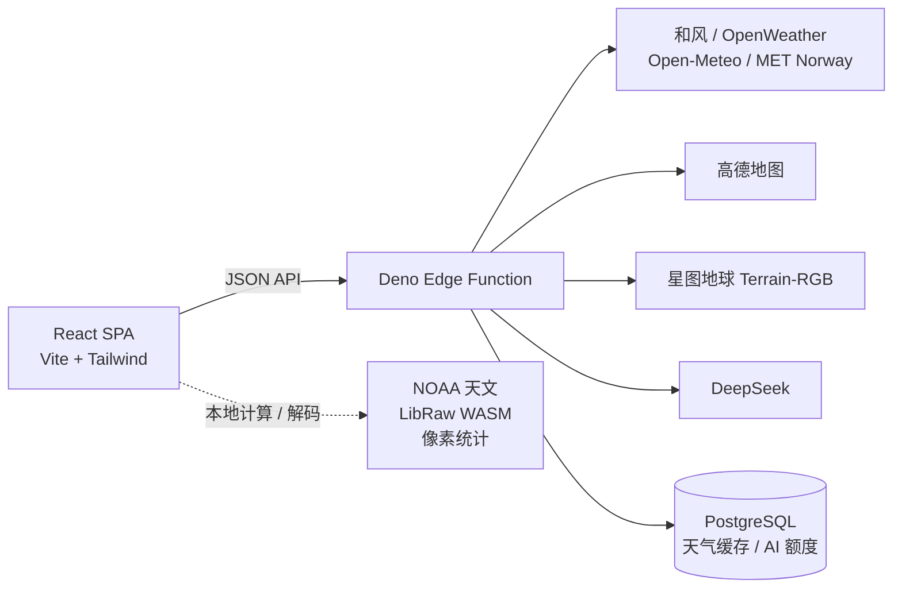

# PhotoMate AI · 智能摄影规划助手

PhotoMate AI 把真实天气、太阳位置与光线窗口组合起来，回答“今天什么时候拍、朝哪拍、怎么拍”。

**在线体验：** <https://photomate-ai-49anbs7e1nr.qoder.zone>

`React 19` · `TypeScript` · `Vite` · `Tailwind CSS 4` · `Deno Edge Function` · `PostgreSQL`

## 最近更新

- **一处选择，四处一致**：机位、计划日期、窗口类型与题材收进同一个拍摄会话；天气、霞光、地点与方案共用，并各自显示当前选择。切换日期后进入方案不会再回到当天。
- **决策信息前置**：天气页先给所选窗口的降雨、阵风、能见度与分层云量，缺测写「暂无数据」；霞光页先给建议到达、推荐窗口、相机朝向，并分开说明霞光评分、火烧云潜力与置信度。
- **机位可落到具体点**：地点推荐区分「去程方向」与「相机朝向」，开放时间/通行/遮挡统一标注「待核实」；光线页新增精确机位，可搜地标、在高德静态图上落针、微调坐标并收藏命名。
- **方案与复盘闭环**：方案继承机位/日期/窗口，支持手机、相机、镜头三栏设备输入，输出到达时间、拍摄方向、曝光起点与备选方案；拍摄记录可导出 .ics，并在拍后关联照片分析、记录实况参数、生成一条下次调整。
- **窗口对比**：同一机位的不同日期，或同一天的不同机位，最多三项并排比较窗口、方向、降雨、阵风、分层云与置信度，只比较预报实际覆盖的时段。
- **照片分析更可执行**：结果把问题整理成带“观察依据”和“下次调整”的优先改进；发送云端前可展开查看字段，明确不含原图、GPS、序列号或人物身份；读取失败可直接重新读取。
- **细节修正**：指标百分比统一取整，移动端选项卡允许换行；异步返回只更新仍匹配当前窗口的结果，避免覆盖用户刚切换的选择。
- **地点搜索失败可直接恢复**：错误块内提供“重新搜索”主操作，非 5xx 响应（如平台 4xx）也不再只剩文字提示；重试会重复失败的搜索或定位动作，已输入的地点保留。备用方式改为“改用手动坐标”，位置条上的“手动坐标”在未选位置时更醒目。
- **未选位置的功能入口更清楚**：实况天气、霞光与光线、拍摄方案、地点推荐四张卡片新增“需要位置”标签与“选择位置后显示…”说明，操作改为描边按钮；说明与操作在 320px 也保留。
- **示例数据标识更明确**：首屏示例卡片的说明直接列出日出日落、云量、能见度与评分均为示例，黄金时刻补充“示例”标签，选择位置后全部替换为真实结果。
- **展开不再牵动并排卡片**：朝霞/晚霞的“潜力”与“火烧云”卡片收起时高度对齐；展开“查看预测依据”只增长自己那张，不再把旁边的卡片一起拉高、留下大块空白。
- **展开过程有过渡**：预测依据改为高度过渡的可控折叠区，展开后内容可聚焦、收起后不进入 Tab 顺序与无障碍树；原生折叠区也补上了淡入。
- **信息层级更清楚**：火烧云的云量判断（分层云条、气溶胶）收进“查看预测依据”，卡片标题下直接给出总云量与观测方向；关键指标保持一屏可读。
- **切换有动效**：二级选项卡、功能导航卡片、日期切换均加入淡入位移动画，并遵循 `prefers-reduced-motion`。
- **导航位置更符合预期**：进入功能页从顶部开始，返回功能导航时回到离开前的位置；日期筛选改为分段控件。
- **首屏更直接**：桌面端改为左侧品牌与位置搜索、右侧今日拍摄条件预览；手机端把照片分析作为独立入口，环境功能使用紧凑卡片。
- **320–360px 适配**：320px 使用单列卡片，保留图标、标题、位置状态与“选择拍摄位置”操作，360px 起恢复两列；卡片标题不再折行，主要操作按钮保持至少 44px 高。
- **位置状态更清晰**：搜索框下方常驻拍摄位置，子页面继续显示位置条；长 GPS 地址在手机端优先显示短地名。
- **手动坐标校验**：空值、缺一项、非数字、超出经纬度范围和中国境外国土范围分别提示，并自动聚焦第一个需要修改的输入框。
- **错误可恢复**：天气、地点搜索、地点推荐、拍摄方案与照片分析使用同一类错误提示，标明失败环节并就近提供重试。
- **照片分析更稳健**：截图/文档/纯色界面检测加入长宽比、文字块、规则边缘和主色特征；置信度不足时显示“可能为…”，支持手动修改题材。
- **EXIF 表述更准确**：相机品牌不再重复；拍摄时间格式化为 `YYYY-MM-DD HH:mm:ss`；区分“镜头焦距”和“等效焦距”，没有可靠换算信息时不写等效值。
- **照片处理保护**：RAW 与大图显示分阶段进度，可取消；内存不足、格式不支持等错误有明确说明；分析失败保留本地统计，只重试云端分析。
- **可访问性**：照片选项卡支持方向键、Home/End、roving tabindex、`aria-controls` 和 `aria-labelledby`；加载与错误区域使用 `aria-live`。
- **收尾**：新增 favicon、SVG 图标与 Apple Touch Icon；无效 hash 自动回到首页，合法 hash 统一为小写。

## 功能

- **四源天气**：和风天气、OpenWeather、Open-Meteo、MET Norway 等权合并，展示实况、温度、云量、分层云、能见度、湿度、气压、风、降水与空气质量。
- **天气趋势**：24 / 48 / 72 小时切换，支持温度、云量、湿度、风速、降水概率，悬停或长按查看逐小时数据。
- **摄影指数**：风光、人像、建筑、夜景、星空、朝霞、晚霞七类独立评分，展开可查看每个因子的数值与贡献。
- **霞光与火烧云**：综合分层云、气溶胶、湿度、能见度、降水与太阳窗口，给出评分、置信度、推荐方向与到达时间。
- **太阳轨迹**：本地 NOAA 算法计算日出日落、晨昏蒙影、黄金/蓝调时刻、方位角与高度角，并叠加星图地球地形地平线。
- **AI 拍摄方案**：按题材生成时间、方向、构图、光线与结构化相机参数；额度用尽时自动切换规则方案。
- **地点推荐**：按题材检索高德 POI，结合日出日落方向给出建议窗口与地图跳转。
- **照片分析**：浏览器本地读取 EXIF、RAW 与画质统计，先推断题材，再由 DeepSeek 复核技术建议；结果按“观察依据 + 下次调整”列出优先改进，发送前可展开查看云端字段。
- **精确机位**：按地标 / POI 搜索、在高德静态图上落针、经纬度微调与收藏命名；选择后联动太阳轨迹，并在地图上绘制当前窗口的相机朝向。
- **窗口对比**：同一机位不同日期，或同一天不同机位，最多三项；并排比较窗口、方向、降雨、阵风、分层云与置信度，并说明哪项更适合当前题材。
- **行程导出与复盘**：拍摄记录保存机位、日期、窗口、到达时间、方案与出门清单，导出 .ics；拍后可关联照片分析、记录实况天气与参数，生成一条下次可尝试的调整。
- **本地记录**：拍摄方案、照片分析、收藏机位与拍后复盘保存在当前浏览器；方案可导出 .ics。

## 移动端与可访问性

- 首屏在桌面端为左右双栏，在手机端顺序展示品牌、位置搜索、主按钮与条件预览。
- 360px 以下使用单列功能卡，保留图标、标题、“需要位置”标签、状态说明与“选择拍摄位置”操作；360px 起显示两列。
- 移动端选项卡允许换行，长标签不会被横向裁切。
- 位置条、错误操作、选项卡、评分说明等交互目标保持至少 44px 高。
- 页面底部预留水印安全间距；平台固定的 “Made with Qoder” 水印可由其自身关闭按钮收起。
- 照片选项卡遵循 WAI-ARIA Tabs 模式；方向键循环切换，Home/End 跳到首尾，非选中项使用 `tabindex="-1"`。
- 加载状态提供骨架屏或明确进度；错误区域使用 `role="alert"` 与 `aria-live`，搜索与定位状态也会向辅助技术播报。

## 错误与恢复

错误提示按失败环节区分，不再使用单一“请求未能完成”：

| 场景 | 提示重点 | 恢复方式 |
| --- | --- | --- |
| 地点搜索 | 网络异常、地点服务不可用、未找到地点 | 重试或改用手动坐标 |
| 天气与光线 | 天气、云层、太阳窗口数据暂不可用 | 保留位置并重试 |
| 地点推荐 | POI 服务或周边搜索失败 | 就近重试或更换位置 |
| 拍摄方案 | 方案生成失败 | 保留题材与条件重试 |
| 照片分析 | 云端分析失败、格式不支持、内存不足 | 仅重试云端分析或重新选择照片 |

用户已输入的地点、坐标、题材和上一次成功结果会尽量保留。照片分析失败时，本地 EXIF、画质统计和题材判断继续显示，不需要重新上传解码。

## 评分说明

- 摄影指数用于比较云量、降水、能见度、风与太阳方位等条件，不是精确预报。
- 晚霞评分还会参考分层层云、气溶胶和太阳窗口；评分依据可在页面中展开查看。
- 数据时区为北京时间（`Asia/Shanghai`）。真实结果会标注页面生成时间与预报获取时间。
- 未选择位置时展示的日出、云量、指数等均为带“示例”标签的界面示意，不代表真实天气；选择位置后替换为实时结果。
- 题材推断来自本地像素统计，DeepSeek 只基于同一组特征复核，不查看原始照片。

## 系统架构



前端负责交互、可视化、天文与像素计算；Edge Function 负责密钥、取数、合并、评分、缓存与 AI 校验；PostgreSQL 保存天气缓存、逐日留存与额度计数。

## 数据来源

| 数据 | 来源 |
| --- | --- |
| 实况、天气现象、空气质量 | 和风天气 |
| 数值预报与逐小时能见度 | OpenWeather |
| 高/中/低云、气溶胶、96 小时预报 | Open-Meteo |
| 分层云量与逐小时预报 | MET Norway |
| 区县、逆地理、摄影点 | 高德地图 Web 服务 |
| 地形高程与遮挡 | 星图地球 Terrain-RGB |
| 机位静态图与 POI | 高德地图 Web 服务（服务端代理） |
| AI 文案与题材复核 | DeepSeek |
| 日出日落、晨昏与太阳轨迹 | 本地 NOAA 算法 |

Open-Meteo 与 MET Norway 数据遵循 **CC BY 4.0**。

## 快速开始

需要 Node.js `^22.13.0 || >=24.0.0`；本地运行函数与测试需要 Deno。

```bash
npm ci
npm run dev          # 前端
npm run check:function
npm run dev:function # Edge Function，127.0.0.1:8000
npm run build
```

本地密钥可通过环境变量注入，字段说明见 [`.env.example`](.env.example)。线上密钥在 **Qoder Sites → Settings → Secrets** 配置。

## 环境变量

| 名称 | 说明 |
| --- | --- |
| `QWEATHER_API_KEY` | 和风天气 API Key |
| `QWEATHER_API_BASE_URL` | 和风天气专属 API Host |
| `OPENWEATHER_API_KEY` | OpenWeather API Key |
| `AMAP_API_KEY` | 高德 Web 服务 Key |
| `DEEPSEEK_API_KEY` | DeepSeek API Key |
| `GEOVIS_EARTH_TOKEN` | 星图地球 Token（地形遮挡） |
| `DEEPSEEK_MODEL` | 默认 `deepseek-chat` |
| `AI_DAILY_LIMIT` | 每日 AI 调用上限，默认 `120` |

Open-Meteo 与 MET Norway 为公开接口。

## 接口

所有接口位于 `/functions/v1/app`：

| 方法 | 路径 | 说明 |
| --- | --- | --- |
| `GET` | `/health` | 服务状态与能力开关 |
| `GET` | `/locations/search?q=` | 城市/区县搜索 |
| `GET` | `/locations/place?q=` | 地标 / POI 检索（精确机位） |
| `GET` | `/map/static?lat=&lng=&zoom=` | 高德静态图（服务端代理，前端不接触 Key） |
| `POST` | `/locations/reverse` | 经纬度逆地理编码 |
| `POST` | `/locations/spots` | 周边摄影点推荐（距离/题材/日出日落筛选） |
| `POST` | `/windows/compare` | 2–3 个窗口对比（日期或机位） |
| `POST` | `/photography/today` | 天气、天文、霞光、指数与时间轴 |
| `POST` | `/plans/custom` | AI / 规则拍摄方案 |
| `POST` | `/photo/analyze` | EXIF、画质与题材分析 |

照片分析请求只上传相机参数、画质统计、题材信号和可选的手动题材标记，不上传原始图像。

## 算法与验证

- **太阳位置**：NOAA Solar Position 计算赤纬、时差、几何高度与大气折射；日出日落与晨昏阈值使用几何高度，黄金/蓝调窗口为 -4°～6°，二分细化到秒级。
- **交叉验证**：NREL SPA 基准案例（Golden, CO · 2003-10-17 19:30:30 UTC）天顶角误差约 **0.003°**、方位角约 **0.002°**；NOAA 北京/上海/广州样例日出日落偏差 **≤1.5 分钟**。
- **摄影评分**：七个题材使用独立权重；因子贡献可加总回总分，缺失字段按剩余权重归一化并在状态中标注。
- **地形遮挡**：3×3 Terrain-RGB 瓦片解码，150m–12km 多距离采样并修正地球曲率，输出每个方位的地平线仰角。
- **AI 方案**：真实天气 → 本地天文 → 条件评分 → AI 组织；返回字段经过校验，异常时回退规则方案。
- **拍摄会话**：机位、计划日期、窗口类型与题材统一保存；异步请求返回时只接受仍匹配当前会话的结果，避免旧响应覆盖用户刚切换的选择。
- **窗口对比**：同一机位不同日期或同一天不同机位最多三项；只比较预报实际覆盖的时段，覆盖不足的窗口会标注并排除推荐。
- **精确机位**：地标 / POI 由服务端检索，高德静态图经函数代理；前端完成 WGS84 / GCJ-02 转换、落针和距离换算。
- **照片优先改进**：规则发现会整理为最多三条“观察依据 + 下次调整”，AI 只润色结论，不改变规则事实。
- **题材复核**：本地像素统计先给出题材和置信度；DeepSeek 只使用可解释的数值信号。截图特征明显时优先标为通用，并允许用户确认或手动指定题材。

参考：Reda & Andreas, *Solar Position Algorithm for Solar Radiation Applications*, NREL/TP-560-34302；[NOAA Solar Calculator](https://gml.noaa.gov/grad/solcalc/)。

## 测试

```bash
npm run build
npx deno fmt --check functions
npx deno lint functions
npx deno test --allow-env functions/
```

`npm run build` 覆盖前端类型检查与生产构建；函数测试需要安装 Deno。自动化环境访问云端服务时可能触发 `BOT_DETECTED`，不能替代普通浏览器中的真实接口验收。地点搜索、天气与霞光、摄影点、AI 照片分析和本地记录仍建议在发布后用普通浏览器逐项复核。

## 项目结构

```text
├─ src/                  React 前端
│  ├─ components/        页面、机位选择、窗口对比与可视化
│  ├─ lib/               API、拍摄会话、天文、像素/RAW、地理/ICS、本地记录
│  └─ globals.css        主题与动效
├─ functions/            Deno Edge Function
│  ├─ providers/         天气、地图、星图、DeepSeek
│  ├─ services/          聚合、评分、指数、方案、对比、缓存
│  ├─ astronomy/         NOAA 太阳计算
│  └─ shared/            共享契约
├─ public/               favicon、SVG 图标、Apple Touch Icon
├─ migrations/           数据库迁移
├─ scripts/              构建脚本
└─ vendor/               样式与许可
```

## 部署

Qoder Sites：构建输出 `dist/`，函数目录 `functions/`，数据库读写；页面使用 hash 路由，无效 hash 会自动回到首页。静态图标随 `public/` 一并进入构建产物。站点当前公开访问。

## 隐私与限制

- 照片、EXIF 与画质分析在浏览器本地处理；原图不上传，GPS 只判断是否存在。发送到云端的字段可在页面展开核对，不包含 GPS 坐标、序列号与人物身份。
- RAW 解码通过 LibRaw WASM 在浏览器内完成；大文件可能占用较多内存，页面提供进度、取消与内存不足提示。
- 截图/文档检测和题材推断都是启发式判断，会给出“可能为”或“通用”，用户可手动修改题材。
- 每次拍摄记录保存在 `localStorage`，清理浏览器后会丢失。
- 地图使用高德 URI 跳转；机位静态图由函数服务代理高德接口，前端不保存 Key；地形地平线约 12km，不含建筑与植被。
- 拍摄记录、收藏机位与 .ics 导出都在浏览器本地完成，不上传服务器。
- 地点推荐列表未逐点计算地形遮挡；星图 Token 缺失时显示“未计算”。
- 第三方密钥通过 Sites Secrets 注入，前端不保存密钥。
- 平台水印位置由 Qoder Sites 控制，应用侧通过底部安全间距减少遮挡，水印可由其自身关闭按钮收起。

## 致谢

- UI 基础来自 Qoder Sites `vinext-starter`，详见 [PROVENANCE.md](PROVENANCE.md)。
- RAW 解码基于 [LibRaw](https://www.libraw.org/)（LGPL-2.1 / CDDL）与 [libraw-wasm](https://www.npmjs.com/package/libraw-wasm)（ISC）。
- 天气、地图、POI 与 AI 文本遵循各自服务商条款。
