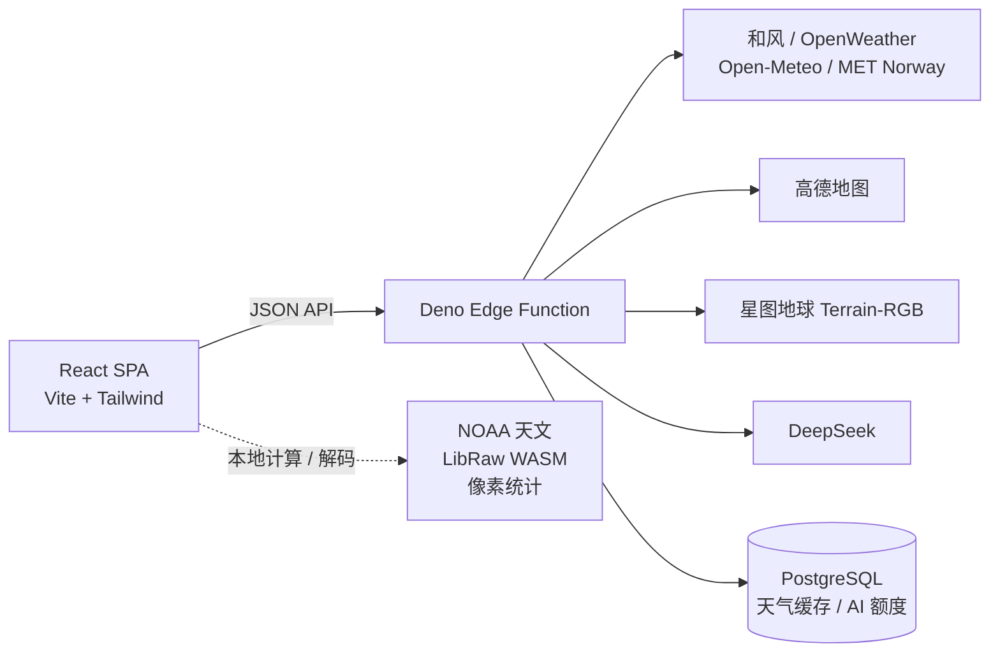

# PhotoMate AI · 智能摄影规划助手

PhotoMate AI 把真实天气、太阳位置与光线窗口组合起来，回答“今天什么时候拍、朝哪拍、怎么拍”。

**在线体验：** <https://photomate-ai-49anbs7e1nr.qoder.zone>

`React 19` · `TypeScript` · `Vite` · `Tailwind CSS 4` · `Deno Edge Function` · `PostgreSQL`

## 功能

- **四源天气**：和风天气、OpenWeather、Open-Meteo、MET Norway 等权合并，展示实况、温度、云量、分层云、能见度、湿度、气压、风、降水与空气质量。
- **天气趋势**：24 / 48 / 72 小时切换，支持温度、云量、湿度、风速、降水概率，悬停或长按查看逐小时数据。
- **摄影指数**：风光、人像、建筑、夜景、星空、朝霞、晚霞七类独立评分，展开可查看每个因子的数值与贡献。
- **霞光与火烧云**：综合分层云、气溶胶、湿度、能见度、降水与太阳窗口，给出评分、置信度、推荐方向与到达时间。
- **太阳轨迹**：本地 NOAA 算法计算日出日落、晨昏蒙影、黄金/蓝调时刻、方位角与高度角，并叠加星图地球地形地平线。
- **AI 拍摄方案**：按题材生成时间、方向、构图、光线与结构化相机参数；额度用尽时自动切换规则方案。
- **地点推荐**：按题材检索高德 POI，结合日出日落方向给出建议窗口与地图跳转。
- **照片分析**：浏览器本地读取 EXIF、RAW 与画质统计，先推断题材，再由 DeepSeek 复核技术建议。
- **本地记录**：拍摄方案与照片分析结果保存在当前浏览器。

## 系统架构



前端负责交互、可视化、天文与像素计算；Edge Function 负责密钥、取数、合并、评分、缓存与 AI 校验；PostgreSQL 保存天气缓存、逐日留存与额度计数。

## 数据来源

| 数据 | 来源 |
| --- | --- |
| 实况、天气现象、空气质量 | 和风天气 |
| 数值预报与逐小时能见度 | OpenWeather |
| 高/中/低云、气溶胶、96 小时预报 | Open-Meteo |
| 分层云量与逐小时预报 | MET Norway |
| 区县、逆地理、摄影点 | 高德地图 Web 服务 |
| 地形高程与遮挡 | 星图地球 Terrain-RGB |
| AI 文案与题材复核 | DeepSeek |
| 日出日落、晨昏与太阳轨迹 | 本地 NOAA 算法 |

Open-Meteo 与 MET Norway 数据遵循 **CC BY 4.0**。

## 快速开始

需要 Node.js `^22.13.0 || >=24.0.0`；本地运行函数与测试需要 Deno。

```bash
npm ci
npm run dev          # 前端
npm run check:function
npm run dev:function # Edge Function，127.0.0.1:8000
npm run build
```

本地密钥可通过环境变量注入，字段说明见 [`.env.example`](.env.example)。线上密钥在 **Qoder Sites → Settings → Secrets** 配置。

## 环境变量

| 名称 | 说明 |
| --- | --- |
| `QWEATHER_API_KEY` | 和风天气 API Key |
| `QWEATHER_API_BASE_URL` | 和风天气专属 API Host |
| `OPENWEATHER_API_KEY` | OpenWeather API Key |
| `AMAP_API_KEY` | 高德 Web 服务 Key |
| `DEEPSEEK_API_KEY` | DeepSeek API Key |
| `GEOVIS_EARTH_TOKEN` | 星图地球 Token（地形遮挡） |
| `DEEPSEEK_MODEL` | 默认 `deepseek-chat` |
| `AI_DAILY_LIMIT` | 每日 AI 调用上限，默认 `120` |

Open-Meteo 与 MET Norway 为公开接口。

## 接口

所有接口位于 `/functions/v1/app`：

| 方法 | 路径 | 说明 |
| --- | --- | --- |
| `GET` | `/health` | 服务状态与能力开关 |
| `GET` | `/locations/search?q=` | 城市/区县搜索 |
| `POST` | `/locations/reverse` | 经纬度逆地理编码 |
| `POST` | `/locations/spots` | 周边摄影点推荐 |
| `POST` | `/photography/today` | 天气、天文、霞光、指数与时间轴 |
| `POST` | `/plans/custom` | AI / 规则拍摄方案 |
| `POST` | `/photo/analyze` | EXIF、画质与题材分析 |

## 算法与验证

- **太阳位置**：NOAA Solar Position 计算赤纬、时差、几何高度与大气折射；日出日落与晨昏阈值使用几何高度，黄金/蓝调窗口为 -4°～6°，二分细化到秒级。
- **交叉验证**：NREL SPA 基准案例（Golden, CO · 2003-10-17 19:30:30 UTC）天顶角误差约 **0.003°**、方位角约 **0.002°**；NOAA 北京/上海/广州样例日出日落偏差 **≤1.5 分钟**。
- **摄影评分**：七个题材使用独立权重；因子贡献可加总回总分，缺失字段按剩余权重归一化并在状态中标注。
- **地形遮挡**：3×3 Terrain-RGB 瓦片解码，150m–12km 多距离采样并修正地球曲率，输出每个方位的地平线仰角。
- **AI 方案**：真实天气 → 本地天文 → 条件评分 → AI 组织；返回字段经过校验，异常时回退规则方案。

参考：Reda & Andreas, *Solar Position Algorithm for Solar Radiation Applications*, NREL/TP-560-34302；[NOAA Solar Calculator](https://gml.noaa.gov/grad/solcalc/)。

## 测试

```bash
npm run build
npx deno fmt --check functions
npx deno lint functions
npx deno test --allow-env functions/
```

当前 **93 项函数测试**全部通过，覆盖天文计算、天气合并、分层云量、霞光/火烧云评分、七题材指数、动态提醒、AI 响应校验、地点推荐与照片分析。

## 项目结构

```text
├─ src/                  React 前端
│  ├─ components/        页面与可视化
│  ├─ lib/               API、天文、像素、RAW、本地记录
│  └─ globals.css        主题与动效
├─ functions/            Deno Edge Function
│  ├─ providers/         天气、地图、星图、DeepSeek
│  ├─ services/          聚合、评分、指数、方案、缓存
│  ├─ astronomy/         NOAA 太阳计算
│  └─ shared/            共享契约
├─ migrations/           数据库迁移
├─ scripts/              构建脚本
└─ vendor/               样式与许可
```

## 部署

Qoder Sites：构建输出 `dist/`，函数目录 `functions/`，开启 SPA 回退与数据库读写；站点公开访问。

## 隐私与限制

- 照片、EXIF 与画质分析在浏览器本地处理；原图不上传，GPS 只判断是否存在。
- 每次拍摄记录保存在 `localStorage`，清理浏览器后会丢失。
- 地图使用高德 URI 跳转；地形地平线约 12km，不含建筑与植被。
- 地点推荐列表未逐点计算地形遮挡；星图 Token 缺失时显示“未计算”。
- 第三方密钥通过 Sites Secrets 注入，前端不保存密钥。

## 致谢

- UI 基础来自 Qoder Sites `vinext-starter`，详见 [PROVENANCE.md](PROVENANCE.md)。
- RAW 解码基于 [LibRaw](https://www.libraw.org/)（LGPL-2.1 / CDDL）与 [libraw-wasm](https://www.npmjs.com/package/libraw-wasm)（ISC）。
- 天气、地图、POI 与 AI 文本遵循各自服务商条款。
