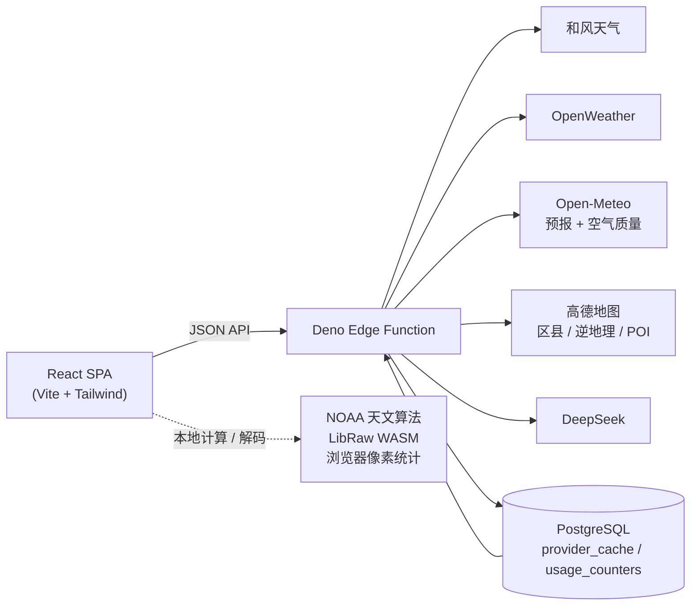

# PhotoMate AI · 智能摄影规划助手

PhotoMate AI 是一个面向摄影爱好者的智能拍摄规划平台：把**真实天气、太阳位置与光线窗口**组合起来，回答“今天什么时候拍、朝哪拍、怎么拍”。

它不做“晴天 = 适合拍照”的简单判断，也不让 AI 编造天气或天文数据。所有评分、时间与方向都来自可解释的数据和本地计算，AI 只负责把事实组织成可执行的拍摄方案。

**在线体验（无需登录）：** <https://photomate-ai-49anbs7e1nr.qoder.zone>

`React 19` · `TypeScript` · `Vite` · `Tailwind CSS 4` · `Deno Edge Function` · `PostgreSQL`

---

## 目录

- [功能亮点](#功能亮点)
- [产品原则](#产品原则)
- [系统架构](#系统架构)
- [数据来源](#数据来源)
- [快速开始](#快速开始)
- [环境变量](#环境变量)
- [接口一览](#接口一览)
- [核心算法](#核心算法)
- [数据库](#数据库)
- [测试](#测试)
- [项目结构](#项目结构)
- [部署](#部署)
- [隐私与边界](#隐私与边界)
- [已知限制](#已知限制)
- [致谢与许可](#致谢与许可)

---

## 功能亮点

### 1. 多源真实天气分析

- 和风天气、OpenWeather、Open-Meteo **三源等权合并**，单源缺失时按可用字段计算。
- 展示温度、体感、湿度、总云量、高/中/低云、降水概率与降水量、风速风向、能见度、气压、空气质量。
- 逐小时温度曲线、云量/降水概率图、逐小时明细与异常天气提醒。
- 明确标注观测时间、数据来源与缺失字段；缺失数据不会被推测值补齐。

### 2. 朝霞、晚霞与火烧云

- 综合高/中/低云、气溶胶光学厚度、湿度、能见度、降水与太阳窗口进行评分（0–100）。
- 分别给出朝霞与晚霞的环境潜力、置信度、评分依据与建议到达时间。
- 火烧云额外输出**环境可能性**与**鲜艳度**：低云遮挡、中高云结构、气溶胶偏高都会触发降分。
- 结果明确说明“环境条件”与“出现概率”的区别。

### 3. 天文时间与太阳轨迹

- 本地 NOAA 算法计算日出日落、民用/航海/天文晨昏蒙影、黄金时刻、蓝调时刻、正午太阳高度。
- 展示日出/日落方位、黄金与蓝调时刻总时长。
- 可拖动的太阳全天轨迹图：实时更新太阳高度与方位，标注金蓝时段与日出日落位置，并配套方向罗盘。
- 基于星图地球 Terrain-RGB 计算地形地平线，标注日出、日落与所选时刻是否被地形遮挡。

### 4. AI 摄影规划

输入拍摄题材，可选填设备与偏好，结合当天真实天气和太阳窗口生成：

- 时间窗口、建议到达时间、拍摄方向与光线分析；
- 题材切入、构图建议与风险提醒；
- 结构化相机参数：ISO、光圈、快门、焦距、曝光补偿、白平衡、对焦模式；
- 基于真实窗口生成的拍摄流程（到达 → 布置 → 开始 → 峰值 → 收尾）。

DeepSeek 返回的参数会与文字说明保持一致；AI 不可用或额度用尽时自动回退为规则方案。

### 5. 摄影地点推荐

- 基于高德 POI，按题材检索周边摄影点，过滤停车场、公交站等服务设施。
- 展示距离、相对方向、地址、建议拍摄窗口与太阳方位提示。
- 提供高德地图跳转链接。

### 6. 摄影指数

- 综合指数 + 风光、人像、城市与街拍、夜景、星空、朝霞、晚霞分项评分。
- 每个指数附评分依据、可用项数量与置信度。
- 星空指数会根据夜间云量与能见度修正；首页展示今日概览与全天趋势。

### 7. 照片分析（JPEG / PNG / WebP / RAW）

- 浏览器本地读取 EXIF 与画质统计：亮度、对比、饱和度、高光/暗部截断、相对清晰度。
- 本地像素特征初步推断题材，DeepSeek 再基于同一组特征复核，并按题材给出针对性建议。
- 支持 NEF、ARW、CR2、CR3、DNG、RAF、ORF、RW2 等 RAW，通过 LibRaw WASM 在浏览器内解码。
- 原图不会上传；GPS 只判断是否存在，不发送坐标。

### 8. 本地拍摄记录

- 在浏览器本地保存生成的拍摄方案与照片分析结果，可查看参数/流程并删除。
- 记录只包含文字与参数，不上传原图，也不同步到服务器。

### 9. 响应式与交互

- 手机、平板、桌面与大屏自适应；已验证 390 / 768 / 1280 / 1920 / 2560 宽度。
- 深色摄影工具界面，重点数据使用卡片、图表、时间轴与方位罗盘呈现。
- 二级页面支持浏览器返回、手势返回与过渡动画。

---

## 产品原则

1. **数据真实**：天气、地图与 POI 来自真实服务，不使用模拟数据填充业务。
2. **算法可靠**：太阳位置与晨昏时间由本地数学算法计算，不依赖第三方天文接口。
3. **AI 有依据**：AI 只基于真实数据与计算结果生成建议，不编造天气、云量或太阳方位。
4. **结果可解释**：每个指数都展示依据、置信度与缺失字段。
5. **国内优先**：优先采用中国大陆可访问的数据服务。

---

## 系统架构



- **前端**：负责交互、可视化、本地天文/像素计算、RAW 解码与本地记录。
- **函数**：负责密钥管理、多源取数、合并、评分、缓存、AI 调用与响应校验。
- **数据库**：缓存多源天气、留存逐日天气与限制 AI 每日额度。

---

## 数据来源

| 数据 | 来源 | 用途 |
| --- | --- | --- |
| 实时与逐小时天气 | 和风天气 | 天气现象优先级、空气质量、逐小时预报 |
| 实时与逐小时天气 | OpenWeather | 多源数值合并 |
| 预报、云层分层、气溶胶 | Open-Meteo（Forecast + Air Quality） | 高/中/低云、AOD、能见度与 96 小时覆盖 |
| 区县、逆地理、摄影点 | 高德地图 Web 服务 | 行政区检索、坐标解析、周边 POI |
| 地形高程 | 星图地球数据云 Terrain-RGB | 3×3 高程瓦片、地平线剖面与地形遮挡 |
| AI 文本 | DeepSeek | 题材复核、方案文案、参数与摘要 |
| 太阳位置与晨昏 | 本地 NOAA 算法 | 日出日落、黄金/蓝调时刻、太阳轨迹 |
| RAW 解码 | LibRaw / libraw-wasm | 浏览器内 RAW 预览与统计 |

> Open-Meteo 数据遵循 **CC BY 4.0**，免费接口用于非商业演示。其他服务遵循各自使用条款。

---

## 快速开始

### 环境要求

- Node.js `^22.13.0 || >=24.0.0`（见 `package.json`）
- Deno（仅在本地运行 Edge Function 或执行函数测试时需要）

### 前端开发

```bash
npm ci
npm run dev
```

访问终端输出的本地地址。前端构建：

```bash
npm run build
npm run preview
```

### 本地 Edge Function

```bash
npm run check:function
npm run dev:function
```

函数默认监听 `127.0.0.1:8000`，Vite 会将 `/functions/v1/app` 代理到该地址。请通过环境变量注入密钥，例如：

```bash
export QWEATHER_API_KEY="..."
export QWEATHER_API_BASE_URL="https://your-api-host.qweatherapi.com"
export OPENWEATHER_API_KEY="..."
export AMAP_API_KEY="..."
export DEEPSEEK_API_KEY="..."
export GEOVIS_EARTH_TOKEN="..."
npm run dev:function
```

生产环境请在 **Qoder Sites → Settings → Secrets** 中配置，不要把密钥写入源码或前端变量。

---

## 环境变量

| 名称 | 必需 | 说明 |
| --- | --- | --- |
| `QWEATHER_API_KEY` | 可选 | 和风天气 API Key |
| `QWEATHER_API_BASE_URL` | 可选 | 和风天气专属 API Host |
| `OPENWEATHER_API_KEY` | 可选 | OpenWeather API Key |
| `AMAP_API_KEY` | 可选 | 高德 Web 服务 Key（区县、逆地理、POI） |
| `DEEPSEEK_API_KEY` | 可选 | DeepSeek API Key |
| `GEOVIS_EARTH_TOKEN` | 可选 | 星图地球数据云 Token（地形遮挡） |
| `DEEPSEEK_MODEL` | 可选 | 默认 `deepseek-chat` |
| `AI_DAILY_LIMIT` | 可选 | 每日 AI 调用上限，默认 `120` |

天气源缺失时页面会明确降级，不会编造数值。Open-Meteo 无需密钥。

---

## 接口一览

所有接口位于 `/functions/v1/app` 下。

| 方法 | 路径 | 说明 |
| --- | --- | --- |
| `GET` | `/health` | 服务状态与已配置能力（不返回密钥） |
| `GET` | `/locations/search?q=` | 中国城市/区县搜索，返回省市区上下文 |
| `POST` | `/locations/reverse` | 经纬度逆地理编码 |
| `POST` | `/locations/spots` | 按位置与题材推荐周边摄影点 |
| `POST` | `/photography/today` | 天气、天文、霞光、火烧云、指数与时间轴聚合 |
| `POST` | `/plans/custom` | 按题材生成 AI/规则拍摄方案 |
| `POST` | `/photo/analyze` | EXIF + 像素统计 + 题材复核照片分析 |

所有写接口均进行结构校验、范围校验与错误降级；请求与响应不包含任何服务端密钥。

---

## 核心算法

### 太阳位置与晨昏

- 采用 NOAA Solar Position 公式计算太阳赤纬、时差、几何高度与大气折射。
- 通过对高度角阈值（-0.833°、-4°、-6°、-12°、-18°）逐分钟扫描与二分细化，得到日出日落、黄金/蓝调与晨昏蒙影时间。
- 生成每 10 分钟一个采样点的全天太阳轨迹，供前端插值与可视化。

### 霞光与火烧云

- 总云量不是唯一变量：同时考虑高/中/低云结构、气溶胶光学厚度、湿度、能见度、降水概率与风速。
- 低云过多、气溶胶偏高、中高云不足会触发硬性降分；缺少分层数据时按剩余权重归一化并降低置信度。

### 地形遮挡

- 通过 Edge Function 代理星图地球 Terrain-RGB 瓦片，Token 不进入前端。
- 将瓦片 RGB 解码为高程，沿每个方位以 150m–12km 多距离采样，计算包含地球曲率修正的地平线仰角。
- 太阳高度低于对应方位地平线时标记为“被地形遮挡”；未配置 Token 或瓦片无效时明确显示未计算。

### 摄影指数

- 对不同题材分别构建时间轴，按可用光线窗口评分。
- 综合指数按题材权重加权；星空指数按夜间平均云量与能见度修正。
- 天气不可用或可用项过少时降低置信度，不输出伪造的高分。

### AI 规划

工作流固定为：**真实天气 → 本地天文 → 条件评分 → AI 组织建议**。AI 输入包含结构化事实与可用窗口，输出经过字段校验；不合法则回退到规则方案。

### 照片题材复核

本地先根据肤色像素、天空/植被占比、边缘密度、中央/边缘清晰度、暗部比例与 EXIF 推断题材；DeepSeek 使用同一组特征再次判断，并输出带数值依据的复核结论。该过程不进行对象识别，也不会声称“看到”照片内容。

---

## 数据库

使用 Qoder Sites PostgreSQL，仅两张表：

- `provider_cache`：多源天气短时缓存与逐日天气留存（按网格 + 日期）。
- `usage_counters`：每日 AI 调用额度控制。

本轮升级未新增或破坏表结构。逐日天气按日期留存 3 天，用于回算已过时段。

---

## 测试

```bash
# 前端类型检查与构建
npm run build

# 函数格式、Lint 与单元测试
npx deno fmt --check functions
npx deno lint functions
npx deno test --allow-env functions/
```

当前结果：**82 项函数测试全部通过**，覆盖天文计算、天气合并、霞光/火烧云评分、摄影指数、AI 响应校验、地点推荐映射与照片分析。

线上还会对真实天气、指数、太阳轨迹、AI 方案、地点推荐、移动端布局与控制台错误进行验收。

---

## 项目结构

```text
├─ src/                  React 前端
│  ├─ components/        页面与可视化组件
│  ├─ lib/               API、格式化、天文/像素/RAW/本地记录
│  └─ globals.css        主题与动效
├─ functions/            Deno Edge Function
│  ├─ providers/         和风、OpenWeather、Open-Meteo、高德、星图、DeepSeek
│  ├─ services/          聚合、评分、指数、方案、照片分析、缓存
│  ├─ astronomy/         NOAA 太阳计算
│  └─ shared/            共享契约与环境工具
├─ migrations/           数据库迁移
├─ scripts/              构建脚本
└─ vendor/               Shadcn 样式与许可
```

---

## 部署

站点部署在 **Qoder Sites**：

- Web 构建输出：`dist/`
- 函数目录：`functions/`
- SPA 回退：开启
- 数据库：只读/读写按功能启用
- 访问方式：公开、无需登录

更新源码后重新构建、准备并发布即可。当前在线地址：<https://photomate-ai-49anbs7e1nr.qoder.zone>

---

## 隐私与边界

- **原始照片不上传**：照片分析在浏览器内完成，服务端只接收 EXIF、统计数值与题材推断结果。
- **GPS 坐标不发送**：只判断照片是否包含 GPS。
- **本地记录不同步**：拍摄记录保存在当前浏览器的 `localStorage`，清理浏览器后会丢失。
- **密钥只在服务端**：所有第三方密钥通过 Sites Secrets 注入，前端不可见。

---

## 已知限制

- **不内嵌地图**：完整地图交互需要高德 JS API Key；当前使用方向罗盘、POI 列表与高德 URI 跳转。
- **地形遮挡范围有限**：星图地球 Terrain-RGB 仅计算约 12km 半径的地形地平线，不含建筑与植被；地点推荐列表未逐点计算地形遮挡。
- **星图 Token 必需**：未配置 `GEOVIS_EARTH_TOKEN` 时地形遮挡会明确显示“未计算”，不会使用推测地形。
- **摄影作品原图与计划/实拍对比**：当前仅保存文字参数与分析记录，未提供原图上传。
- **极端纬度/极昼极夜**：无日出或晨昏事件时返回“暂不可用”，不会编造时间。
- **AI 额度**：公共演示使用每日额度限制，额度用尽时自动回退规则方案。

---

## 致谢与许可

- UI 基础来自 Qoder Sites 的 `vinext-starter` 模板，详见 [PROVENANCE.md](PROVENANCE.md)。
- RAW 解码基于 [LibRaw](https://www.libraw.org/)（LGPL-2.1 / CDDL）与 [libraw-wasm](https://www.npmjs.com/package/libraw-wasm)（ISC）。
- 天气、地图、POI 与 AI 文本遵循各自服务商条款；Open-Meteo 数据遵循 CC BY 4.0。

PhotoMate AI 是摄影辅助工具，指数与环境评分为辅助决策，不替代官方气象预报与现场判断。
